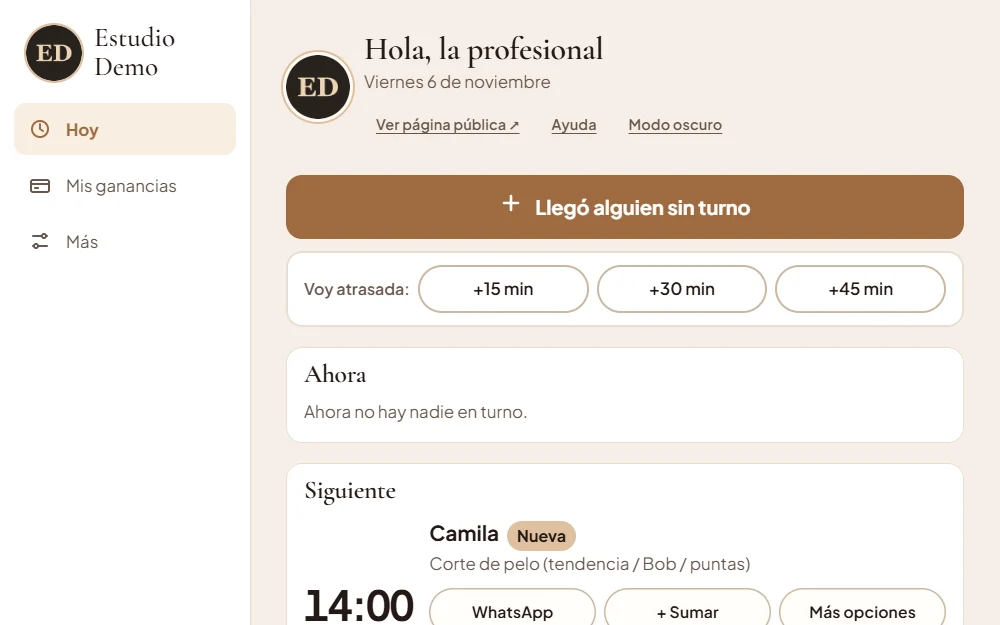
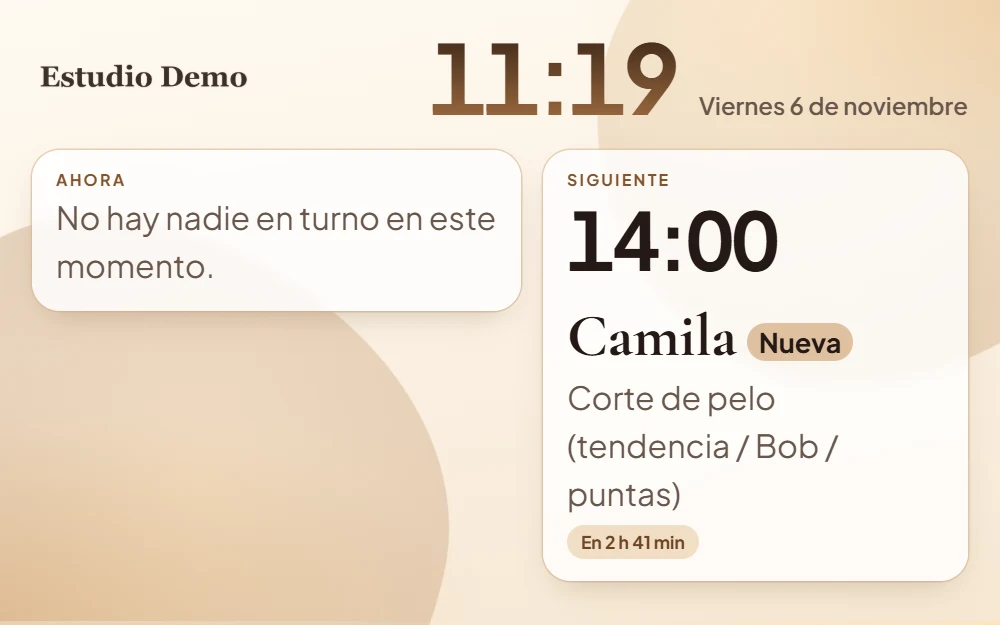

# Booking Peluquería

Sistema de turnos online para una peluquería o centro de estética, con un panel para quien atiende. Es una aplicación web sin framework ni paso de compilación: HTML, CSS y JavaScript.

Esta es la versión de demostración y es genérica. El negocio, los servicios, los horarios y las imágenes son de ejemplo (las fotos están generadas, no hay personas).

Demo: https://booking-peluqueria-demo.vercel.app (el panel, sin contraseña, está en `/panel.html`).





Más trabajos en mi portfolio: https://portfolio-fawn-kappa-35.vercel.app

## Qué hace

**Para la clienta** (`index.html`)
- Elegir un servicio del catálogo (color y mechas, tratamientos, cortes y peinados) y reservar un horario.
- La duración del turno cambia según el largo del pelo y si ya tiene tintura o decoloración.
- Ver los trabajos de ejemplo de cada servicio.

**Para quien atiende** (`panel.html`)
- Vista de hoy con el turno actual y el siguiente.
- Anotar a alguien que llegó sin turno y avisar cuando se está atrasada (+15, +30 o +45 minutos).
- Ganancias, ajustes de servicios y horarios.

**Otras páginas**
- `estoy-aca.html`: la clienta avisa que llegó.
- `pared.html`: pantalla con el día para el local.
- `cartel.html`, `tarjeta.html` y `qr.html`: carteles imprimibles y QR de cobro.
- `ayuda.html` y `manual.html`: ayuda de uso.

## Cómo está hecho

- Cada servicio define su duración total y los minutos de espera (por ejemplo, el tiempo de un color), durante los cuales quien atiende queda libre para algo corto. La agenda se acomoda con eso. Los datos están en `datos.js`.
- Los datos que carga cada visitante se guardan en su navegador (`localStorage`), por eso no hace falta base de datos ni cuenta. En esta versión el panel abre sin contraseña y lo que se carga no lo ve nadie más.
- El proyecto original usaba además un servicio en la nube para sincronizar entre dispositivos. Esa parte se sacó de esta versión.

## Cómo probarlo

No necesita instalar nada. Desde esta carpeta:

```
python -m http.server 8000
```

y abrir http://localhost:8000. El panel está en http://localhost:8000/panel.html.

## Estructura

```
index.html, app.js          página pública de turnos
panel.html, panel*.js       panel de gestión
store.js                    datos y lógica de agenda
datos.js                    negocio, catálogo y horarios (de ejemplo)
trabajos.js, img/demo/      trabajos de ejemplo
```
